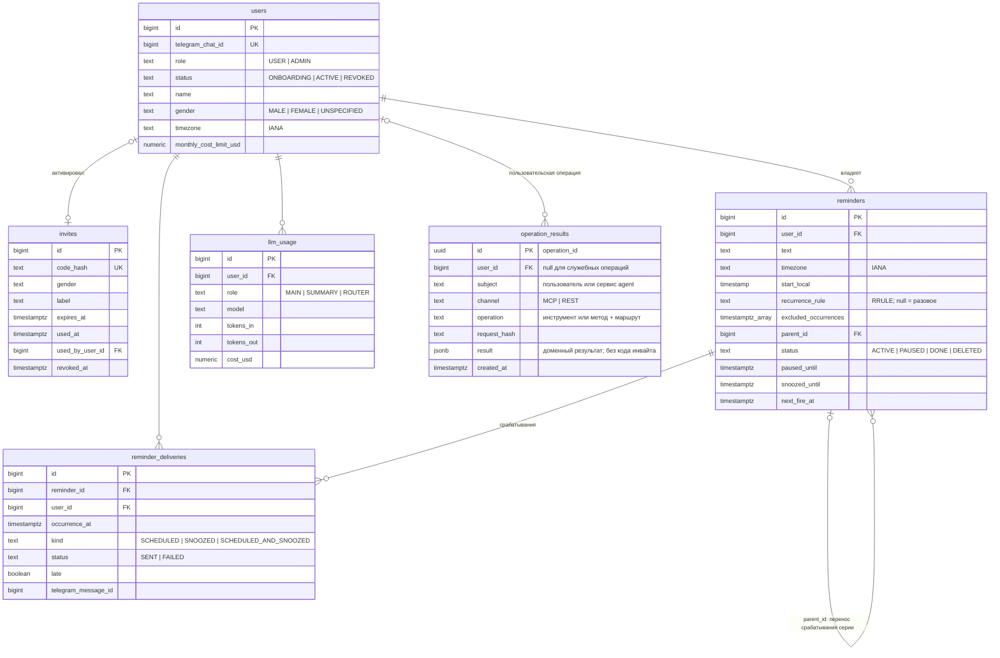
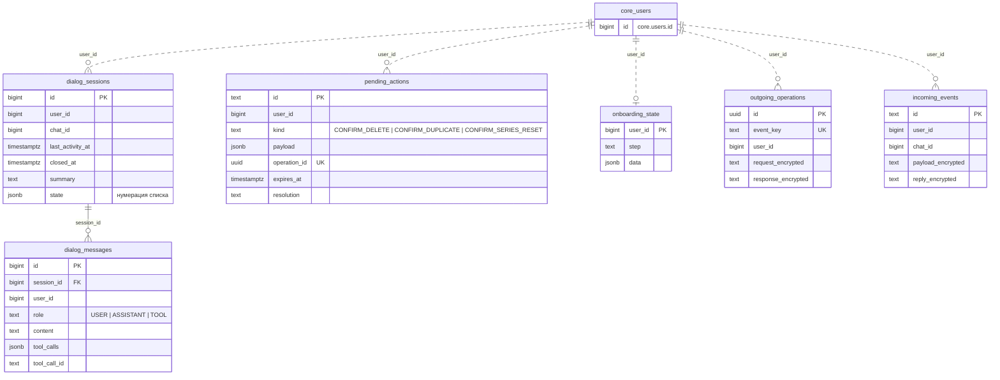
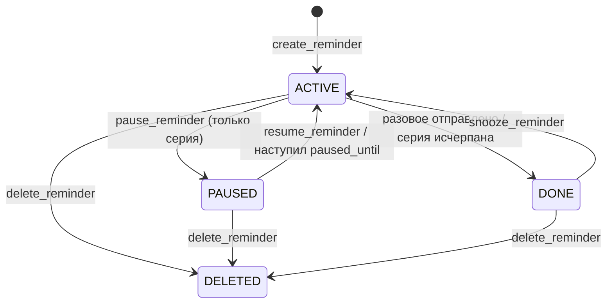
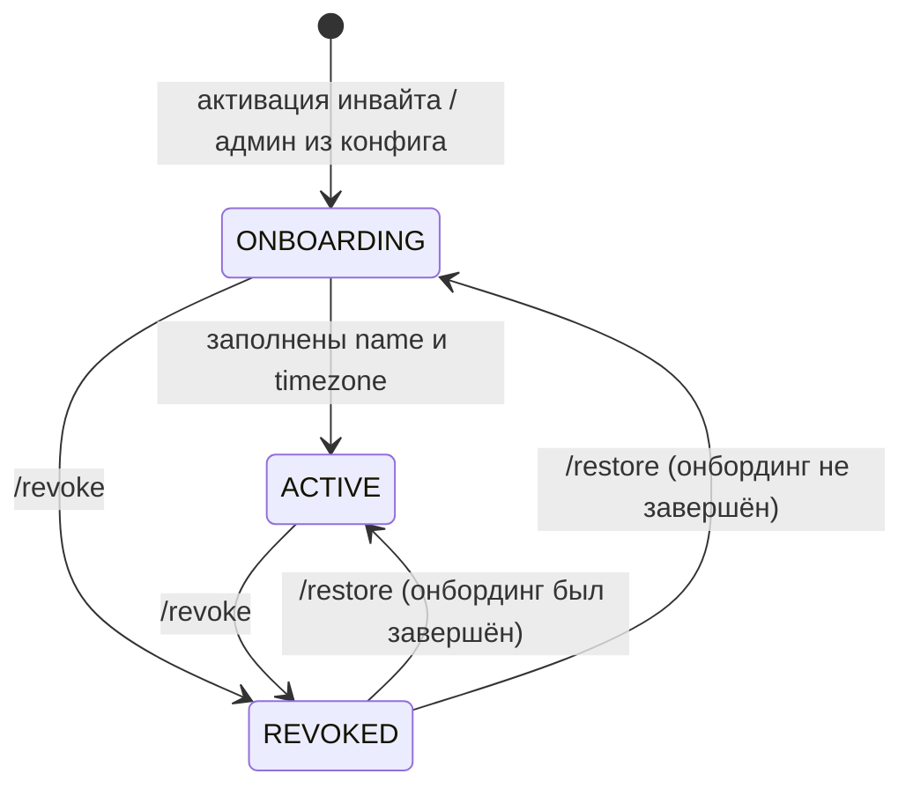

# Схема БД v1

Статус: утверждена владельцем 2026-11-02 (этап 1). Миграции Flyway пишутся по этому документу на этапах 2–4; после применения первой миграции документ описывает фактическую схему, а изменения идут только новыми аддитивными миграциями.

**Реализация (этап 3):**
- Миграция `core/src/main/resources/db/migration/core/V1__users_reminders_deliveries.sql` применяет `users`, `reminders`, `reminder_deliveries` по схеме ниже. Core выполняет её при старте.
- Миграция core `V2__accounts_and_operations.sql` создаёт `invites`, `llm_usage`, `operation_results`. Agent применяет собственную `V1__system_operations_and_onboarding.sql`: `outgoing_operations`, `incoming_events`, `onboarding_state`.
- Новый админ создаётся в `ONBOARDING`; существующая строка не меняется. Таблицы истории диалога и `pending_actions` остаются целевыми.
- Разовые напоминания: `recurrence_rule` пуст (`null`), серии и `parent_id` пока не используются.

Решения и причины — `docs/DECISIONS.md`, раздел 11.

## Общее

- Один PostgreSQL, две схемы: `core` (сервис core) и `agent` (сервис agent). Каждый сервис мигрирует только свою схему своим Flyway (`flyway.schemas`), отдельные таблицы истории `flyway_schema_history` в каждой схеме. Сервис подключается под своей ролью БД с правами только на свою схему.
- agent **не читает** схему `core` — только через MCP/REST. Связь между схемами — логическая (`user_id`), без внешних ключей между схемами.
- Время — `timestamptz` (UTC). Локальное «настенное» время — `timestamp` (без зоны) **всегда в паре** с IANA-таймзоной.
- Статусы — enum в коде + `check` в БД. Значения в БД — `UPPER_SNAKE`.
- Целевое требование мягкого чтения после ревью: неизвестное старой версии значение статуса / enum-подобного поля сохраняется в исходном виде, не обрушает процесс, список или тик и не заменяется действующим статусом. Пользователь с неизвестным статусом не получает доступ/LLM; напоминание в неизвестном состоянии не отправляется и не изменяется, явная операция даёт `unsupported_state`. Остальные записи обрабатываются; запись других полей не должна затирать исходное неизвестное значение. Это ещё не реализация и не разрешение скрывать произвольные ошибки или повреждение данных.
- Каждая таблица с пользовательскими данными имеет `user_id` и индекс, начинающийся с него.
- Идентификаторы — `bigint generated always as identity`, кроме явно описанных UUID ключей операций и строковых ключей `pending_actions`.
- `created_at`/`updated_at` выставляет код через `Clock` (не `default now()`), чтобы время было тестируемым.

## Диаграммы

Mermaid `erDiagram`, рендерится GitHub/GitLab и IntelliJ (плагин Mermaid). Показаны ключи и связи; полный список колонок — в таблицах ниже. Меняется вместе с таблицами.

### `core`

### `agent`

`user_id` — логическая ссылка на `core.users.id`, без внешнего ключа между схемами (пунктир). `dialog_sessions`, `dialog_messages` и `pending_actions` на диаграмме — целевые таблицы этапа 5.

### Статусы `reminders`

### Статусы `users`

## Схема `core`

### `users` — пользователи

| Колонка | Тип | Null | Описание |
|---|---|---|---|
| `id` | bigint PK | | внутренний id пользователя; именно он ходит между сервисами как `userId` |
| `telegram_chat_id` | bigint unique | | chatId личного чата с ботом |
| `role` | text | | `USER` \| `ADMIN` |
| `status` | text | | `ONBOARDING` \| `ACTIVE` \| `REVOKED` |
| `name` | text | да | как обращаться; заполняется в онбординге |
| `gender` | text | | грамматический род: `MALE` \| `FEMALE` \| `UNSPECIFIED` |
| `timezone` | text | да | IANA (`Europe/Moscow`); заполняется в онбординге, валидируется кодом |
| `monthly_cost_limit_usd` | numeric(12,6) | да | поле лимита; `null` — без лимита. В текущей реализации квоты выключены |
| `created_at` | timestamptz | | |
| `updated_at` | timestamptz | | |
| `onboarded_at` | timestamptz | да | момент перехода `ONBOARDING → ACTIVE` |
| `revoked_at` | timestamptz | да | |

- Переходы статуса: `ONBOARDING → ACTIVE` (код, когда заполнены `name` и `timezone`) · `ACTIVE/ONBOARDING → REVOKED` (админ, `/revoke`) · `REVOKED → ACTIVE` (админ, `/restore`; если онбординг не был завершён — `REVOKED → ONBOARDING`). При восстановлении `revoked_at` сбрасывается.
- Пока пользователь в `REVOKED`, планировщик не отправляет уведомления; наступившее разовое напоминание закрывается без доставки, после восстановления оно не досылается. Правила серий — этап 4.
- Админ создаётся core при старте из конфига (`THESEUS_ADMIN_CHAT_ID`), идемпотентно, со статусом `ONBOARDING` и ролью `ADMIN`; дальше — обычный онбординг. Существующая строка не меняется.
- check: `status = 'ACTIVE'` ⇒ `name` и `timezone` не null.

### `invites` — инвайты

| Колонка | Тип | Null | Описание |
|---|---|---|---|
| `id` | bigint PK | | |
| `code_hash` | text unique | | SHA-256 от кода (hex); открытого кода в таблице нет. Agent хранит содержимое системного события и ответа в зашифрованном виде |
| `gender` | text | | род будущего пользователя: `MALE` \| `FEMALE` \| `UNSPECIFIED` |
| `label` | text | да | пометка админа («для мамы») — видна в `/users` и в уведомлении об активации |
| `created_at` | timestamptz | | |
| `expires_at` | timestamptz | | `created_at` + TTL (конфиг, по умолчанию 72 ч) |
| `used_at` | timestamptz | да | |
| `used_by_user_id` | bigint FK → users | да | |
| `revoked_at` | timestamptz | да | |

- Состояние инвайта **вычисляется**, не хранится: `USED` (есть `used_at`) → `REVOKED` (есть `revoked_at`) → `EXPIRED` (`expires_at ≤ now`) → иначе `ACTIVE`. Так нет рассинхрона статуса и времени.
- Код: 16 символов из алфавита без похожих символов (base32 Crockford), `SecureRandom`; уходит в deep link `t.me/<bot>?start=<код>` (лимит payload 64 символа — с запасом).
- Активация — одна транзакция: `select … for update` по `code_hash`, проверка состояния, создание пользователя, `used_at`/`used_by_user_id`.
- check: `used_at` и `used_by_user_id` заданы оба или ни один.

### `reminders` — напоминания

Одна строка — одно разовое напоминание **или** одна серия. Расписание задаётся одинаково: локальное время старта + таймзона (+ RRULE для серии). Колонка `next_fire_at` — производная: ближайшее срабатывание в UTC, её пересчитывает код после любого изменения и после каждой отправки; по ней работает планировщик.

| Колонка | Тип | Null | Описание |
|---|---|---|---|
| `id` | bigint PK | | |
| `user_id` | bigint FK → users | | |
| `text` | text | | что напомнить (до 1000 символов, check) |
| `timezone` | text | | IANA-таймзона, в которой задано расписание (снимок таймзоны пользователя на момент создания) |
| `start_local` | timestamp | | разовое — момент срабатывания; серия — первое срабатывание (`DTSTART` из RFC 5545), локальное время |
| `recurrence_rule` | text | да | `null` — разовое; иначе правило повторения в формате `RRULE` из RFC 5545, без `DTSTART` (`FREQ=WEEKLY;BYDAY=MO,WE`), собирает код |
| `excluded_occurrences` | timestamptz[] | | исключённые срабатывания серии (`EXDATE` из RFC 5545): пропуск, перенос одного срабатывания; по умолчанию `{}` |
| `parent_id` | bigint FK → reminders | да | для разового напоминания, созданного переносом одного срабатывания серии |
| `status` | text | | `ACTIVE` \| `PAUSED` \| `DONE` \| `DELETED` |
| `paused_until` | timestamptz | да | только для `PAUSED`; `null` — пауза бессрочная |
| `snoozed_until` | timestamptz | да | отложенное срабатывание (snooze); после отправки сбрасывается |
| `next_fire_at` | timestamptz | да | ближайшее срабатывание: `min(следующее по расписанию, snoozed_until)`; `null` — срабатываний больше нет |
| `last_fired_at` | timestamptz | да | |
| `created_at` | timestamptz | | |
| `updated_at` | timestamptz | | |
| `deleted_at` | timestamptz | да | |

- Статусы: `ACTIVE` — ждёт срабатывания · `PAUSED` — серия на паузе (только серии) · `DONE` — разовое отправлено / серия исчерпана (`UNTIL`/`COUNT`) · `DELETED` — удалено пользователем (мягкое удаление; физически не удаляем в v1).
  Это уточнение «`PENDING → SENT`» из `DECISIONS.md` §2: для разового `ACTIVE → DONE`, а факт отправки каждого срабатывания пишется в `reminder_deliveries`.
- check: `recurrence_rule is null` ⇒ `status <> 'PAUSED'` и `excluded_occurrences = '{}'`; `paused_until is not null` ⇒ `status = 'PAUSED'`; `status in ('DONE','DELETED')` ⇒ `next_fire_at is null`.
- Индексы: `(user_id, status)`; частичный `(next_fire_at) where status = 'ACTIVE'` — для планировщика; частичный `(paused_until) where status = 'PAUSED'` — для автоснятия паузы.
- Несуществующее локальное время (переход на летнее) сдвигается вперёд на величину перехода, неоднозначное (переход на зимнее) — берётся более раннее смещение. Считает код, кейсы — в тестах этапа 4.
- Смена таймзоны пользователя существующие напоминания **не** пересчитывает; новые получают текущую зону профиля. Зона самого напоминания возвращается в `ReminderView` и явно показывается, если отличается от профиля. Массовое изменение зон требует отдельного явного действия.
- Целевые правила после ревью 2026-11-05 (ещё не реализованы): изменение расписания серии атомарно очищает исключения и отменяет невыполненные дочерние переносы после подтверждения последствий; изменение только текста их сохраняет. Пауза очищает `snoozed_until`, возобновление его не восстанавливает. Snooze при `PAUSED` запрещён.
- При совпадении обычного и отложенного срабатывания серии по одному моменту отправляется одно уведомление и погашаются оба основания. После простоя разовое досылается с пометкой опоздания; серия — только последнее пропущенное обычное срабатывание, затем будущие. За время паузы / отзыва доступа досыла нет. Политика просроченного snooze серии требует отдельного уточнения (`docs/api/mcp.md`).

### `reminder_deliveries` — журнал отправок

| Колонка | Тип | Null | Описание |
|---|---|---|---|
| `id` | bigint PK | | |
| `reminder_id` | bigint FK → reminders | | |
| `user_id` | bigint FK → users | | денормализовано для фильтрации по пользователю |
| `occurrence_at` | timestamptz | | плановое время срабатывания (для snooze — время отложенного срабатывания) |
| `kind` | text | | `SCHEDULED` \| `SNOOZED` \| `SCHEDULED_AND_SNOOZED` (целевое дополнение после ревью: совпавшие основания одной доставки) |
| `status` | text | | `SENT` \| `FAILED` |
| `late` | boolean | | отправлено с опозданием (досыл после простоя) |
| `sent_at` | timestamptz | да | |
| `telegram_message_id` | bigint | да | id сообщения-уведомления; для reply и кнопок |
| `error` | text | да | причина `FAILED` (без текста напоминания) |
| `created_at` | timestamptz | | |

- unique `(reminder_id, occurrence_at, kind)` — защита журнала от повторной записи одного основания. Доставка Telegram остаётся «как минимум один раз»: сбой после отправки до коммита может дать повтор (§13 `DECISIONS.md`).
- Индексы: `(user_id, created_at)`; unique `(user_id, telegram_message_id)` — поиск напоминания по reply.
- Совпавшие обычное и отложенное срабатывания записываются одной строкой с `kind = 'SCHEDULED_AND_SNOOZED'` и одним `telegram_message_id`; оба основания погашаются одной транзакцией. Проверка обработанности `SCHEDULED` или `SNOOZED` учитывает и объединённый вид; одного существующего unique для этого недостаточно. Новый вид добавляется аддитивной миграцией с расширением check. Неизвестный вид безопасно пропускается без изменения записи; это покрывается целевой регрессионной проверкой мягкого чтения, без матрицы многоверсионных прогонов.

### `llm_usage` — учёт вызовов LLM

| Колонка | Тип | Null | Описание |
|---|---|---|---|
| `id` | bigint PK | | |
| `user_id` | bigint FK → users | | |
| `role` | text | | роль модели: `MAIN` \| `SUMMARY` \| `ROUTER` |
| `model` | text | | фактическая модель из ответа OpenRouter (после fallback) |
| `generation_id` | text | да | id генерации OpenRouter — для сверки |
| `tokens_in` | integer | | |
| `tokens_out` | integer | | |
| `tokens_cached` | integer | | по умолчанию 0 |
| `cost_usd` | numeric(12,8) | | стоимость из ответа OpenRouter |
| `latency_ms` | integer | да | |
| `created_at` | timestamptz | | |

- Индекс `(user_id, created_at)`. Тексты запросов/ответов **не** хранятся.

### `operation_results` — результаты изменяющих операций

Таблица создана миграцией `V2`. Используется изменяющими REST-запросами с `Idempotency-Key`; применение к MCP `_meta["theseus/operation_id"]` остаётся задачей этапа 4. Правила повторов — `docs/api/mcp.md` и `docs/api/rest.md`.

| Колонка | Тип | Null | Описание |
|---|---|---|---|
| `id` | uuid PK | | UUID операции, назначенный кодом агента; уникален для MCP и REST вместе в БД стенда |
| `user_id` | bigint FK → users | да | пользовательская операция; `null` у служебных операций, в том числе до регистрации |
| `subject` | text | | стабильный субъект операции: пользователь либо аутентифицированный сервис agent |
| `channel` | text | | `MCP` \| `REST` |
| `operation` | text | | имя инструмента либо HTTP-метод и маршрут с конкретными идентификаторами |
| `request_hash` | text | | SHA-256 канонического запроса; включает контекст субъекта, операцию и payload; отсутствие поля отличается от `null` |
| `result` | jsonb | | исходный доменный результат; у REST также HTTP-статус; для создания инвайта только квитанция без открытого кода |
| `created_at` | timestamptz | | |

- Запись результата и доменное изменение коммитятся одной транзакцией. Уникальность ключа и транзакционная синхронизация исключают одновременное исполнение одного ключа; при конфликте не возвращается результат другого субъекта.
- Перед выдачей сохранённого результата заново проверяются аутентификация, применимые права и принадлежность данных. Повтор возвращает исходный результат без пересчёта времени; актуальное состояние читается отдельно.
- Индекс `(user_id, created_at)`. Записи в v1 автоматически не удаляются: повтор старого ключа не должен запустить действие заново. Результат содержит пользовательские данные и подчиняется политике их удаления; отдельные сроки хранения ещё не установлены.
- Исходный payload с `invite_code` не хранится: `request_hash` содержит только хэш, `result` — квитанцию без открытого кода. Повтор запроса создания инвайта возвращает `code: null` и `code_unavailable: true`, без создания нового инвайта (`docs/api/rest.md`).
- Agent сохраняет исходящие операции и системные события в своей схеме; содержимое запроса, события и ответа зашифровано. `pending_actions` для будущих подтверждений пока не реализована.

## Схема `agent`

### `outgoing_operations` — исходящие системные операции

| Колонка | Тип | Null | Описание |
|---|---|---|---|
| `id` | uuid PK | | ключ `Idempotency-Key` для core |
| `event_key` | text unique | | стабильный идентификатор шага исходного события |
| `user_id` | bigint | да | логическая ссылка на пользователя core |
| `method`, `path` | text | | HTTP-метод и маршрут |
| `request_encrypted` | text | | зашифрованное тело запроса |
| `response_status` | integer | да | HTTP-статус ответа |
| `response_encrypted` | text | да | зашифрованное тело ответа |
| `created_at`, `completed_at` | timestamptz | `completed_at` | время создания и завершения |

Индексы: `(user_id, created_at)` и частичный `(created_at)` для незавершённых записей. Завершённая операция хранит ответ, повтор события использует исходный UUID.

### `incoming_events` — системные события Telegram

| Колонка | Тип | Null | Описание |
|---|---|---|---|
| `id` | text PK | | идентификатор события |
| `user_id` | bigint | да | логическая ссылка на пользователя core |
| `chat_id` | bigint | | чат получателя |
| `payload_encrypted` | text | | зашифрованный снимок системного входа, профиля и предложения зоны; для обычного диалога — маркер без входного текста |
| `reply_encrypted` | text | да | зашифрованный ответ с кнопками и уведомлением админу |
| `created_at`, `delivered_at` | timestamptz | `delivered_at` | время создания и доставки |

Индексы: `(user_id, created_at)` и частичный `(created_at)` для недоставленных событий. Запись предшествует исполнению, после рестарта недоставленные события восстанавливаются. Для незавершённого диалога используется ответ о неподтверждённом исходе без повторного вызова LLM или MCP; завершённый ответ переиспользуется. Отправка в Telegram может повториться при сбое после отправки и до фиксации доставки.

Содержимое обоих журналов защищено AES-256-GCM ключом `THESEUS_JOURNAL_KEY` из env; nonce случаен, дополнительная аутентификация привязывает данные к записи и их назначению. Открытые коды инвайтов в таблицах не хранятся. Ключ нужен для чтения записей и восстановления операций; правила сохранения ключа — `docs/operations.md`.

### `dialog_sessions` — сессии диалога

**Целевая таблица этапа 5; ещё не создана.**

Новая сессия начинается, если с `last_activity_at` прошло больше порога (конфиг, по умолчанию 4 ч). Старая сессия закрывается; в v1 её саммари автоматически в новую сессию не переносится.

| Колонка | Тип | Null | Описание |
|---|---|---|---|
| `id` | bigint PK | | |
| `user_id` | bigint | | id пользователя core |
| `chat_id` | bigint | | |
| `started_at` | timestamptz | | |
| `last_activity_at` | timestamptz | | |
| `closed_at` | timestamptz | да | |
| `summary` | text | да | скользящее саммари всего, что старше окна последних сообщений |
| `summary_until_message_id` | bigint | да | последнее сообщение, вошедшее в саммари |
| `state` | jsonb | | состояние сессии: нумерация последнего списка (`номер → reminderId`) и т.п.; по умолчанию `{}` |

- Индекс `(user_id, last_activity_at)`; частичный unique `(user_id) where closed_at is null` — одна открытая сессия на пользователя.
- Целевая политика после ревью 2026-11-05: саммари используется в открытой сессии; после закрытия хранится 30 дней от `closed_at`, затем очищается фоновой задачей. Это отдельный срок от срока хранения сырых сообщений; постоянная память о пользователе сюда не входит.

### `dialog_messages` — сообщения

**Целевая таблица этапа 5; ещё не создана.**

| Колонка | Тип | Null | Описание |
|---|---|---|---|
| `id` | bigint PK | | |
| `session_id` | bigint FK → dialog_sessions | | |
| `user_id` | bigint | | |
| `role` | text | | `USER` \| `ASSISTANT` \| `TOOL` |
| `content` | text | да | текст; для `TOOL` — сжатый результат инструмента |
| `tool_calls` | jsonb | да | для `ASSISTANT`: вызовы инструментов (имя, аргументы, id) |
| `tool_call_id` | text | да | для `TOOL`: на какой вызов ответ |
| `telegram_message_id` | bigint | да | входящее/исходящее сообщение Telegram |
| `created_at` | timestamptz | | |

- Индексы `(session_id, id)`, `(user_id, created_at)`.
- Хранение: сообщения старше N дней (конфиг, по умолчанию 30) удаляются фоновой задачей агента. Саммари закрытой сессии очищается отдельно через 30 дней от `closed_at`.

### `pending_actions` — ожидающие подтверждения

Действия, которые агент показал пользователю кнопками и ждёт ответа: подтверждение удаления, «всё равно создать» при дубле, сброс исключений и невыполненных переносов серии. `callback_data` кнопки содержит только `pa:<id>:<вариант>`, всё остальное — здесь. Дополнения после ревью — целевая схема, не реализация этапа 2.

| Колонка | Тип | Null | Описание |
|---|---|---|---|
| `id` | text PK | | короткий случайный id (12 символов base32) |
| `user_id` | bigint | | |
| `kind` | text | | `CONFIRM_DELETE` \| `CONFIRM_DUPLICATE` \| `CONFIRM_SERIES_RESET` |
| `payload` | jsonb | | имя MCP-инструмента, зафиксированные аргументы, конкретная цель / срабатывание и снимок значимых показанных данных |
| `operation_id` | uuid unique | | ключ исполнения подтверждённого действия в core; сохраняется до первого вызова и повторно используется после рестарта / повторного callback |
| `telegram_message_id` | bigint | да | сообщение с кнопками — чтобы убрать кнопки после ответа |
| `created_at` | timestamptz | | |
| `expires_at` | timestamptz | | `created_at` +1 час, без автоматического продления |
| `resolved_at` | timestamptz | да | |
| `resolution` | text | да | `CONFIRMED` \| `CANCELLED` \| `EXPIRED` |

- Индекс `(user_id, created_at)`. Нажатие проверяет: `user_id` совпадает с пользователем чата, не истекло, не разрешено.
- Подтверждение не вычисляет заново «ближайшее» срабатывание. Истёкший срок, изменившиеся значимые данные или прошедшее целевое срабатывание требуют новой карточки. Проверка актуальности с доменным изменением должна быть атомарной в core; техническое представление условия (версия / снимок) предстоит определить до реализации. Проверки только в агенте недостаточно из-за гонки с планировщиком и другими изменениями.
- Запись разрешения карточки может отстать от коммита core. Повтор с тем же `operation_id` возвращает исходный результат и позволяет завершить запись разрешения без повторного изменения данных. Создание после `possible_duplicate` имеет новый ключ относительно первоначального запроса создания.
- Истечение часа запрещает новое исполнение, но не восстановление уже закоммиченного результата с прежним ключом после проверки доступа: такой повтор не оценивает карточку как новое действие и не применяет изменение второй раз.

### `onboarding_state` — состояние онбординга

FSM онбординга детерминированный; шаг выводится из профиля в core (`name`/`timezone` пусты), здесь — только промежуточное состояние, которого в профиле нет.

| Колонка | Тип | Null | Описание |
|---|---|---|---|
| `user_id` | bigint PK | | |
| `step` | text | | `AWAIT_NAME` \| `AWAIT_TIMEZONE` \| `AWAIT_TIMEZONE_CONFIRM` |
| `data` | jsonb | | предложенная таймзона и идентификатор подтверждения |
| `updated_at` | timestamptz | | |

- В реализации запись используется для предложения таймзоны на шаге `AWAIT_TIMEZONE_CONFIRM`. Этап имени и отсутствие таймзоны определяются профилем core. Строка удаляется после завершения онбординга.
