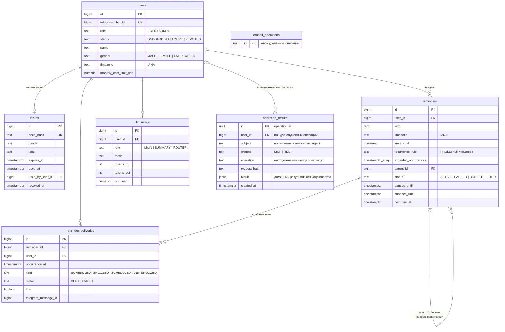
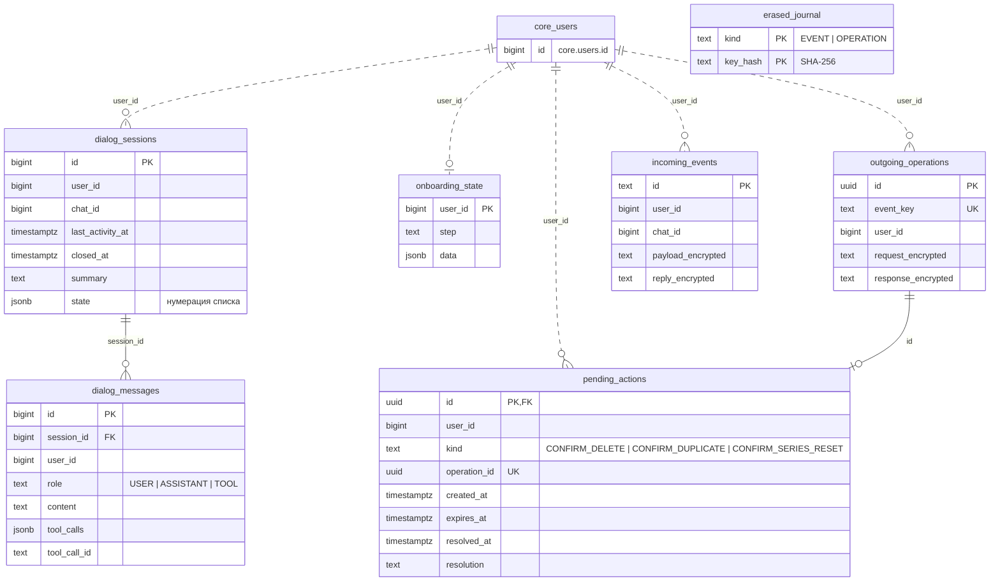
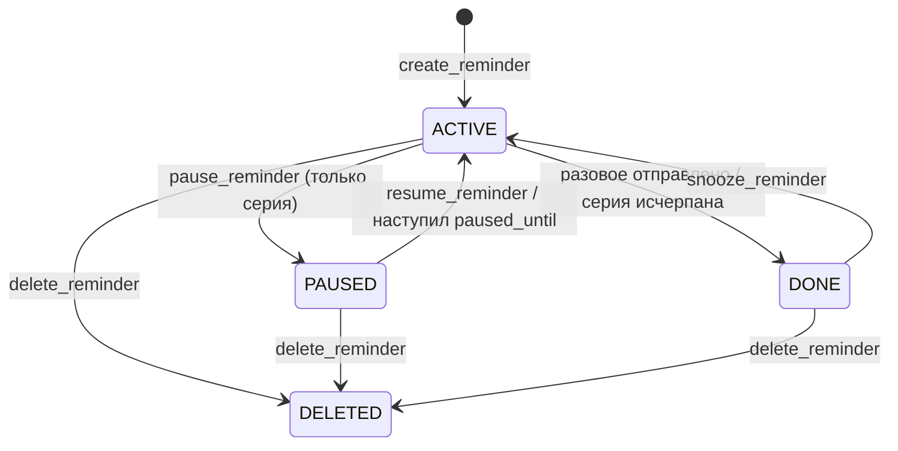
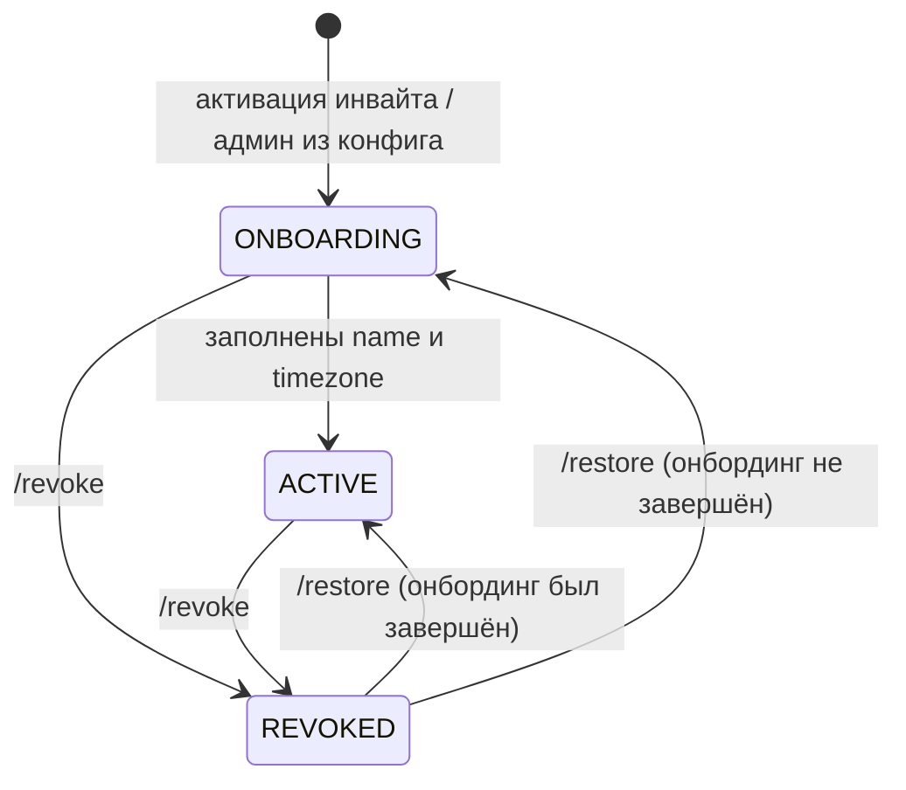

# Схема БД v1

Статус: утверждена владельцем 2026-11-02 (этап 1). Миграции Flyway пишутся по этому документу на этапах 2–4; после применения первой миграции документ описывает фактическую схему, а изменения идут только новыми аддитивными миграциями.

**Реализация (этап 4):**
- Миграция `core/src/main/resources/db/migration/core/V1__users_reminders_deliveries.sql` применяет `users`, `reminders`, `reminder_deliveries` по схеме ниже. Core выполняет её при старте.
- Миграция core `V2__accounts_and_operations.sql` создаёт `invites`, `llm_usage`, `operation_results`. Agent применяет собственную `V1__system_operations_and_onboarding.sql`: `outgoing_operations`, `incoming_events`, `onboarding_state`.
- Миграция core `V3__erased_operations.sql` создаёт `erased_operations`; agent `V2__erased_journal.sql` создаёт `erased_journal`. Таблицы сохраняют минимальные идентификаторы для защиты от повторов после тестового удаления пользователя.
- Миграция core `V4__combined_deliveries.sql` расширяет допустимые виды доставки значением `SCHEDULED_AND_SNOOZED`; новые поля напоминаний не добавляются. Agent `V3__pending_actions.sql` создаёт индекс карточек подтверждения без открытого содержимого.
- Новый админ создаётся в `ONBOARDING`; существующая строка не меняется. Таблицы истории диалога остаются целевыми; подтверждения используют `pending_actions` и зашифрованный журнал `outgoing_operations`.
- Разовые напоминания имеют `recurrence_rule = null`; серии хранят RRULE, переносы отдельных срабатываний используют `parent_id`.

Решения и причины — `docs/DECISIONS.md`, раздел 11.

## Общее

- Один PostgreSQL, две схемы: `core` (сервис core) и `agent` (сервис agent). Каждый сервис мигрирует только свою схему своим Flyway (`flyway.schemas`), отдельные таблицы истории `flyway_schema_history` в каждой схеме. Сервис подключается под своей ролью БД с правами только на свою схему.
- agent **не читает** схему `core` — только через MCP/REST. Связь между схемами — логическая (`user_id`), без внешних ключей между схемами.
- Время — `timestamptz` (UTC). Локальное «настенное» время — `timestamp` (без зоны) **всегда в паре** с IANA-таймзоной.
- Статусы — enum в коде + `check` в БД. Значения в БД — `UPPER_SNAKE`.
- На этапе 4 реализована мягкая обработка неизвестного состояния напоминания и частоты RRULE: запись не отправляется и не изменяется, явная операция даёт `unsupported_state`, остальные записи обрабатываются. Обобщённая защита неизвестных значений пользователей и API — целевое требование этапа 7. Произвольные ошибки или повреждение данных скрывать нельзя.
- Каждая таблица с пользовательскими данными имеет `user_id` и индекс, начинающийся с него.
- Идентификаторы — `bigint generated always as identity`, кроме явно описанных ключей событий и UUID операций и карточек подтверждения.
- `created_at`/`updated_at` выставляет код через `Clock` (не `default now()`), чтобы время было тестируемым.

## Диаграммы

Mermaid `erDiagram`, рендерится GitHub/GitLab и IntelliJ (плагин Mermaid). Показаны ключи и связи; полный список колонок — в таблицах ниже. Меняется вместе с таблицами.

### `core`

### `agent`

`user_id` — логическая ссылка на `core.users.id`, без внешнего ключа между схемами (пунктир). `dialog_sessions` и `dialog_messages` на диаграмме — целевые таблицы; карточки используют `pending_actions` и `outgoing_operations`.

### Статусы `reminders`

### Статусы `users`

## Схема `core`

### `users` — пользователи

| Колонка | Тип | Null | Описание |
|---|---|---|---|
| `id` | bigint PK | | внутренний id пользователя; именно он ходит между сервисами как `userId` |
| `telegram_chat_id` | bigint unique | | chatId личного чата с ботом |
| `role` | text | | `USER` \| `ADMIN` |
| `status` | text | | `ONBOARDING` \| `ACTIVE` \| `REVOKED` |
| `name` | text | да | как обращаться; заполняется в онбординге |
| `gender` | text | | грамматический род: `MALE` \| `FEMALE` \| `UNSPECIFIED` |
| `timezone` | text | да | IANA (`Europe/Moscow`); заполняется в онбординге, валидируется кодом |
| `monthly_cost_limit_usd` | numeric(12,6) | да | поле лимита; `null` — без лимита. В текущей реализации квоты выключены |
| `created_at` | timestamptz | | |
| `updated_at` | timestamptz | | |
| `onboarded_at` | timestamptz | да | момент перехода `ONBOARDING → ACTIVE` |
| `revoked_at` | timestamptz | да | |

- Переходы статуса: `ONBOARDING → ACTIVE` (код, когда заполнены `name` и `timezone`) · `ACTIVE/ONBOARDING → REVOKED` (админ, `/revoke`) · `REVOKED → ACTIVE` (админ, `/restore`; если онбординг не был завершён — `REVOKED → ONBOARDING`). При восстановлении `revoked_at` сбрасывается.
- Пока пользователь в `REVOKED`, планировщик не отправляет уведомления; наступившее разовое напоминание закрывается без доставки, после восстановления оно не досылается. Срабатывания серии за время отзыва не досылаются.
- Админ создаётся core при старте из конфига (`THESEUS_ADMIN_CHAT_ID`), идемпотентно, со статусом `ONBOARDING` и ролью `ADMIN`; дальше — обычный онбординг. Существующая строка не меняется.
- check: `status = 'ACTIVE'` ⇒ `name` и `timezone` не null.

### `invites` — инвайты

| Колонка | Тип | Null | Описание |
|---|---|---|---|
| `id` | bigint PK | | |
| `code_hash` | text unique | | SHA-256 от кода (hex); открытого кода в таблице нет. Agent хранит содержимое системного события и ответа в зашифрованном виде |
| `gender` | text | | род будущего пользователя: `MALE` \| `FEMALE` \| `UNSPECIFIED` |
| `label` | text | да | пометка админа («для мамы») — видна в `/users` и в уведомлении об активации |
| `created_at` | timestamptz | | |
| `expires_at` | timestamptz | | `created_at` + TTL (конфиг, по умолчанию 72 ч) |
| `used_at` | timestamptz | да | |
| `used_by_user_id` | bigint FK → users | да | |
| `revoked_at` | timestamptz | да | |

- Состояние инвайта **вычисляется**, не хранится: `USED` (есть `used_at`) → `REVOKED` (есть `revoked_at`) → `EXPIRED` (`expires_at ≤ now`) → иначе `ACTIVE`. Так нет рассинхрона статуса и времени.
- Код: 16 символов из алфавита без похожих символов (base32 Crockford), `SecureRandom`; уходит в deep link `t.me/<bot>?start=<код>` (лимит payload 64 символа — с запасом).
- Активация — одна транзакция: `select … for update` по `code_hash`, проверка состояния, создание пользователя, `used_at`/`used_by_user_id`.
- check: `used_at` и `used_by_user_id` заданы оба или ни один.

### `reminders` — напоминания

Одна строка — одно разовое напоминание **или** одна серия. Расписание задаётся одинаково: локальное время старта + таймзона (+ RRULE для серии). Колонка `next_fire_at` — производная: ближайшее срабатывание в UTC, её пересчитывает код после любого изменения и после каждой отправки; по ней работает планировщик.

| Колонка | Тип | Null | Описание |
|---|---|---|---|
| `id` | bigint PK | | |
| `user_id` | bigint FK → users | | |
| `text` | text | | что напомнить (до 1000 символов, check) |
| `timezone` | text | | IANA-таймзона, в которой задано расписание (снимок таймзоны пользователя на момент создания) |
| `start_local` | timestamp | | разовое — момент срабатывания; серия — первое срабатывание (`DTSTART` из RFC 5545), локальное время |
| `recurrence_rule` | text | да | `null` — разовое; иначе правило повторения в формате `RRULE` из RFC 5545, без `DTSTART` (`FREQ=WEEKLY;BYDAY=MO,WE`), собирает код |
| `excluded_occurrences` | timestamptz[] | | исключённые срабатывания серии (`EXDATE` из RFC 5545): пропуск, перенос одного срабатывания; по умолчанию `{}` |
| `parent_id` | bigint FK → reminders | да | для разового напоминания, созданного переносом одного срабатывания серии |
| `status` | text | | `ACTIVE` \| `PAUSED` \| `DONE` \| `DELETED` |
| `paused_until` | timestamptz | да | только для `PAUSED`; `null` — пауза бессрочная |
| `snoozed_until` | timestamptz | да | отложенное срабатывание (snooze); после отправки сбрасывается |
| `next_fire_at` | timestamptz | да | ближайшее срабатывание: `min(следующее по расписанию, snoozed_until)`; `null` — срабатываний больше нет |
| `last_fired_at` | timestamptz | да | |
| `created_at` | timestamptz | | |
| `updated_at` | timestamptz | | |
| `deleted_at` | timestamptz | да | |

- Статусы: `ACTIVE` — ждёт срабатывания · `PAUSED` — серия на паузе (только серии) · `DONE` — разовое отправлено / серия исчерпана (`UNTIL`/`COUNT`) · `DELETED` — удалено пользователем (мягкое удаление; физически не удаляем в v1).
  Это уточнение «`PENDING → SENT`» из `DECISIONS.md` §2: для разового `ACTIVE → DONE`, а факт отправки каждого срабатывания пишется в `reminder_deliveries`.
- check: `recurrence_rule is null` ⇒ `status <> 'PAUSED'` и `excluded_occurrences = '{}'`; `paused_until is not null` ⇒ `status = 'PAUSED'`; `status in ('DONE','DELETED')` ⇒ `next_fire_at is null`.
- Индексы: `(user_id, status)`; частичный `(next_fire_at) where status = 'ACTIVE'` — для планировщика; частичный `(paused_until) where status = 'PAUSED'` — для автоснятия паузы.
- Несуществующее локальное время (переход на летнее) сдвигается вперёд на величину перехода, неоднозначное (переход на зимнее) — берётся более раннее смещение. Считает код, кейсы — в тестах этапа 4.
- Смена таймзоны пользователя существующие напоминания **не** пересчитывает; новые получают текущую зону профиля. Зона самого напоминания возвращается в `ReminderView` и явно показывается, если отличается от профиля. Массовое изменение зон требует отдельного явного действия.
- Изменение расписания серии атомарно очищает исключения и отменяет активных и приостановленных потомков переносов после подтверждения последствий, включая потомков переноса, превращённого в серию. Изменение только текста или передача прежнего расписания их сохраняет. Пауза очищает `snoozed_until`, возобновление его не восстанавливает. Snooze при `PAUSED` запрещён.
- При совпадении обычного и отложенного срабатывания серии по одному моменту отправляется одно уведомление и погашаются оба основания. После простоя разовое досылается с пометкой опоздания; серия — только последнее пропущенное обычное срабатывание и просроченный snooze, затем будущие. За время паузы / отзыва доступа досыла нет (`docs/api/mcp.md`).

### `reminder_deliveries` — журнал отправок

| Колонка | Тип | Null | Описание |
|---|---|---|---|
| `id` | bigint PK | | |
| `reminder_id` | bigint FK → reminders | | |
| `user_id` | bigint FK → users | | денормализовано для фильтрации по пользователю |
| `occurrence_at` | timestamptz | | плановое время срабатывания (для snooze — время отложенного срабатывания) |
| `kind` | text | | `SCHEDULED` \| `SNOOZED` \| `SCHEDULED_AND_SNOOZED` (совпавшие основания одной доставки) |
| `status` | text | | `SENT` \| `FAILED` |
| `late` | boolean | | отправлено с опозданием (досыл после простоя) |
| `sent_at` | timestamptz | да | |
| `telegram_message_id` | bigint | да | id сообщения-уведомления; для reply и кнопок |
| `error` | text | да | причина `FAILED` (без текста напоминания) |
| `created_at` | timestamptz | | |

- unique `(reminder_id, occurrence_at, kind)` — защита журнала от повторной записи одного основания. Доставка Telegram остаётся «как минимум один раз»: сбой после отправки до коммита может дать повтор (§13 `DECISIONS.md`).
- Индексы: `(user_id, created_at)`; unique `(user_id, telegram_message_id)` — поиск напоминания по reply.
- Совпавшие обычное и отложенное срабатывания записываются одной строкой с `kind = 'SCHEDULED_AND_SNOOZED'` и одним `telegram_message_id`; оба основания погашаются одной транзакцией. Миграция `V4` расширяет check допустимых видов доставки.

### `llm_usage` — учёт вызовов LLM

| Колонка | Тип | Null | Описание |
|---|---|---|---|
| `id` | bigint PK | | |
| `user_id` | bigint FK → users | | |
| `role` | text | | роль модели: `MAIN` \| `SUMMARY` \| `ROUTER` |
| `model` | text | | фактическая модель из ответа OpenRouter (после fallback) |
| `generation_id` | text | да | id генерации OpenRouter — для сверки |
| `tokens_in` | integer | | |
| `tokens_out` | integer | | |
| `tokens_cached` | integer | | по умолчанию 0 |
| `cost_usd` | numeric(12,8) | | стоимость из ответа OpenRouter |
| `latency_ms` | integer | да | |
| `created_at` | timestamptz | | |

- Индекс `(user_id, created_at)`. Тексты запросов/ответов **не** хранятся.

### `operation_results` — результаты изменяющих операций

Таблица создана миграцией `V2`. Используется изменяющими REST-запросами с `Idempotency-Key` и MCP-запросами с `_meta["theseus/operation_id"]`. Правила повторов — `docs/api/mcp.md` и `docs/api/rest.md`.

| Колонка | Тип | Null | Описание |
|---|---|---|---|
| `id` | uuid PK | | UUID операции, назначенный кодом агента; уникален для MCP и REST вместе в БД стенда |
| `user_id` | bigint FK → users | да | пользовательская операция; `null` у служебных операций, в том числе до регистрации |
| `subject` | text | | стабильный субъект операции: пользователь либо аутентифицированный сервис agent |
| `channel` | text | | `MCP` \| `REST` |
| `operation` | text | | имя инструмента либо HTTP-метод и маршрут с конкретными идентификаторами |
| `request_hash` | text | | SHA-256 канонического запроса; субъект, канал и операция проверяются отдельно; отсутствие поля отличается от `null` |
| `result` | jsonb | | исходный доменный результат; у REST также HTTP-статус; для создания инвайта только квитанция без открытого кода |
| `created_at` | timestamptz | | |

- Запись результата и доменное изменение коммитятся одной транзакцией. Уникальность ключа и транзакционная синхронизация исключают одновременное исполнение одного ключа; при конфликте не возвращается результат другого субъекта.
- Перед выдачей сохранённого результата заново проверяются аутентификация, применимые права и принадлежность данных. Повтор возвращает исходный результат без пересчёта времени; актуальное состояние читается отдельно.
- Индекс `(user_id, created_at)`. Записи автоматически по времени не удаляются. При тестовом полном удалении пользователя связанные квитанции очищаются; их UUID сохраняются в `erased_operations`, чтобы старый ключ не запустил действие заново.
- Исходный payload с `invite_code` не хранится: `request_hash` содержит только хэш, `result` — квитанцию без открытого кода. Повтор запроса создания инвайта возвращает `code: null` и `code_unavailable: true`, без создания нового инвайта (`docs/api/rest.md`).
- Agent сохраняет исходящие операции, карточки подтверждений и системные события в своей схеме; содержимое запроса, события и ответа зашифровано.

### `erased_operations` — ключи удалённых операций

Миграция core `V3`: `id uuid` — первичный ключ без связи с пользователем, запроса или результата. При тестовом удалении сюда переносятся UUID затронутых квитанций, после чего квитанции удаляются. Повтор такого UUID возвращает `410 user_erased`.

## Схема `agent`

### `erased_journal` — отметки удалённых записей журнала

Миграция agent `V2`: составной первичный ключ `kind text` (`EVENT` или `OPERATION`) и `key_hash text` (SHA-256 ключа события или операции). Таблица не хранит `user_id`, `chat_id`, имя, запрос или ответ. Отметки не дают техническому повтору восстановить удалённое событие или операцию.

`/hard_delete ID` на test сначала блокирует пользователя в core, затем очищает в agent его входящие события, исходящие операции, состояние онбординга и связанные административные кэши; после этого core удаляет профиль, напоминания и доставки, usage, использованные инвайты и соответствующие квитанции. Чат синхронизирован общей блокировкой обработки и удаления. При восстановлении после потерянного ответа agent проверяет текущий `user_id` чата, чтобы не очистить данные новой регистрации. Команда не меняет старые бэкапы или сообщения Telegram.

### `outgoing_operations` — исходящие операции и подтверждения

| Колонка | Тип | Null | Описание |
|---|---|---|---|
| `id` | uuid PK | | ключ операции core или идентификатор карточки подтверждения |
| `event_key` | text unique | | стабильный идентификатор шага исходного события |
| `user_id` | bigint | да | логическая ссылка на пользователя core |
| `method`, `path` | text | | HTTP-метод и маршрут либо `MCP` / `CONFIRM` и имя инструмента |
| `request_encrypted` | text | | зашифрованное тело запроса |
| `response_status` | integer | да | HTTP-статус ответа |
| `response_encrypted` | text | да | зашифрованное тело ответа |
| `created_at`, `completed_at` | timestamptz | `completed_at` | время создания и завершения |

Индексы: `(user_id, created_at)` и частичный `(created_at)` для незавершённых записей. Завершённая операция хранит ответ, повтор события использует исходный UUID. Карточка `CONFIRM` хранит зашифрованные аргументы, снимок и время подтверждения; отдельная операция `MCP` сохраняет UUID до вызова core.

### `incoming_events` — системные события Telegram

| Колонка | Тип | Null | Описание |
|---|---|---|---|
| `id` | text PK | | идентификатор события |
| `user_id` | bigint | да | логическая ссылка на пользователя core |
| `chat_id` | bigint | | чат получателя |
| `payload_encrypted` | text | | зашифрованный снимок системного входа, профиля и предложения зоны; для обычного диалога — маркер без входного текста |
| `reply_encrypted` | text | да | зашифрованный ответ с кнопками и уведомлением админу |
| `created_at`, `delivered_at` | timestamptz | `delivered_at` | время создания и доставки |

Индексы: `(user_id, created_at)` и частичный `(created_at)` для недоставленных событий. Запись предшествует исполнению, после рестарта недоставленные события восстанавливаются. Незавершённый диалог не запускает новый вызов LLM; отдельно восстанавливаются сохранённые MCP-операции с исходными ключами. Завершённый ответ переиспользуется. Отправка в Telegram может повториться при сбое после отправки и до фиксации доставки.

Содержимое обоих журналов защищено AES-256-GCM ключом `THESEUS_JOURNAL_KEY` из env; nonce случаен, дополнительная аутентификация привязывает данные к записи и их назначению. Открытые коды инвайтов в таблицах не хранятся. Ключ нужен для чтения записей и восстановления операций; правила сохранения ключа — `docs/operations.md`.

### `dialog_sessions` — сессии диалога

**Целевая таблица этапа 5; ещё не создана.**

Новая сессия начинается, если с `last_activity_at` прошло больше порога (конфиг, по умолчанию 4 ч). Старая сессия закрывается; в v1 её саммари автоматически в новую сессию не переносится.

| Колонка | Тип | Null | Описание |
|---|---|---|---|
| `id` | bigint PK | | |
| `user_id` | bigint | | id пользователя core |
| `chat_id` | bigint | | |
| `started_at` | timestamptz | | |
| `last_activity_at` | timestamptz | | |
| `closed_at` | timestamptz | да | |
| `summary` | text | да | скользящее саммари всего, что старше окна последних сообщений |
| `summary_until_message_id` | bigint | да | последнее сообщение, вошедшее в саммари |
| `state` | jsonb | | состояние сессии: нумерация последнего списка (`номер → reminderId`) и т.п.; по умолчанию `{}` |

- Индекс `(user_id, last_activity_at)`; частичный unique `(user_id) where closed_at is null` — одна открытая сессия на пользователя.
- Целевая политика после ревью 2026-11-05: саммари используется в открытой сессии; после закрытия хранится 30 дней от `closed_at`, затем очищается фоновой задачей. Это отдельный срок от срока хранения сырых сообщений; постоянная память о пользователе сюда не входит.

### `dialog_messages` — сообщения

**Целевая таблица этапа 5; ещё не создана.**

| Колонка | Тип | Null | Описание |
|---|---|---|---|
| `id` | bigint PK | | |
| `session_id` | bigint FK → dialog_sessions | | |
| `user_id` | bigint | | |
| `role` | text | | `USER` \| `ASSISTANT` \| `TOOL` |
| `content` | text | да | текст; для `TOOL` — сжатый результат инструмента |
| `tool_calls` | jsonb | да | для `ASSISTANT`: вызовы инструментов (имя, аргументы, id) |
| `tool_call_id` | text | да | для `TOOL`: на какой вызов ответ |
| `telegram_message_id` | bigint | да | входящее/исходящее сообщение Telegram |
| `created_at` | timestamptz | | |

- Индексы `(session_id, id)`, `(user_id, created_at)`.
- Хранение: сообщения старше N дней (конфиг, по умолчанию 30) удаляются фоновой задачей агента. Саммари закрытой сессии очищается отдельно через 30 дней от `closed_at`.

### `pending_actions` — индекс карточек подтверждения

Миграция agent `V3` создаёт индекс карточек удаления, создания поверх дубля и сброса исключений. Открытое содержимое карточки не дублируется: запрос, цель, снимок и ответ хранятся зашифрованными в записи `CONFIRM` таблицы `outgoing_operations`.

| Колонка | Тип | Null | Описание |
|---|---|---|---|
| `id` | uuid PK, FK → outgoing_operations | | идентификатор карточки; удаление записи журнала каскадно удаляет индекс |
| `user_id` | bigint | | логическая ссылка на пользователя core |
| `kind` | text | | `CONFIRM_DELETE` \| `CONFIRM_DUPLICATE` \| `CONFIRM_SERIES_RESET` |
| `operation_id` | uuid unique | | UUID будущего MCP-вызова, назначается при создании карточки |
| `created_at`, `expires_at` | timestamptz | | время создания и истечения через час |
| `resolved_at` | timestamptz | да | время разрешения |
| `resolution` | text | да | `CONFIRMED` \| `CANCELLED` \| `EXPIRED` |

Индекс `(user_id, created_at)`. Callback содержит `rem:yes:<UUID>` или `rem:no:<UUID>`. Core атомарно сверяет `fingerprint` и время создания с данными при изменении; прошедшее срабатывание и изменившиеся данные требуют новой карточки. Если действие уже зафиксировано в core, повтор с тем же ключом возвращает прежний результат и не исполняет его второй раз. Отмена после начатого исполнения сначала выясняет его исход.

### `onboarding_state` — состояние онбординга

FSM онбординга детерминированный; шаг выводится из профиля в core (`name`/`timezone` пусты), здесь — только промежуточное состояние, которого в профиле нет.

| Колонка | Тип | Null | Описание |
|---|---|---|---|
| `user_id` | bigint PK | | |
| `step` | text | | `AWAIT_NAME` \| `AWAIT_TIMEZONE` \| `AWAIT_TIMEZONE_CONFIRM` |
| `data` | jsonb | | предложенная таймзона и идентификатор подтверждения |
| `updated_at` | timestamptz | | |

- В реализации запись используется для предложения таймзоны на шаге `AWAIT_TIMEZONE_CONFIRM`. Этап имени и отсутствие таймзоны определяются профилем core. Строка удаляется после завершения онбординга.
