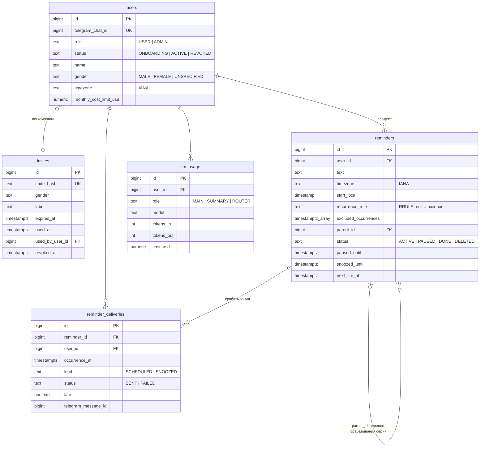
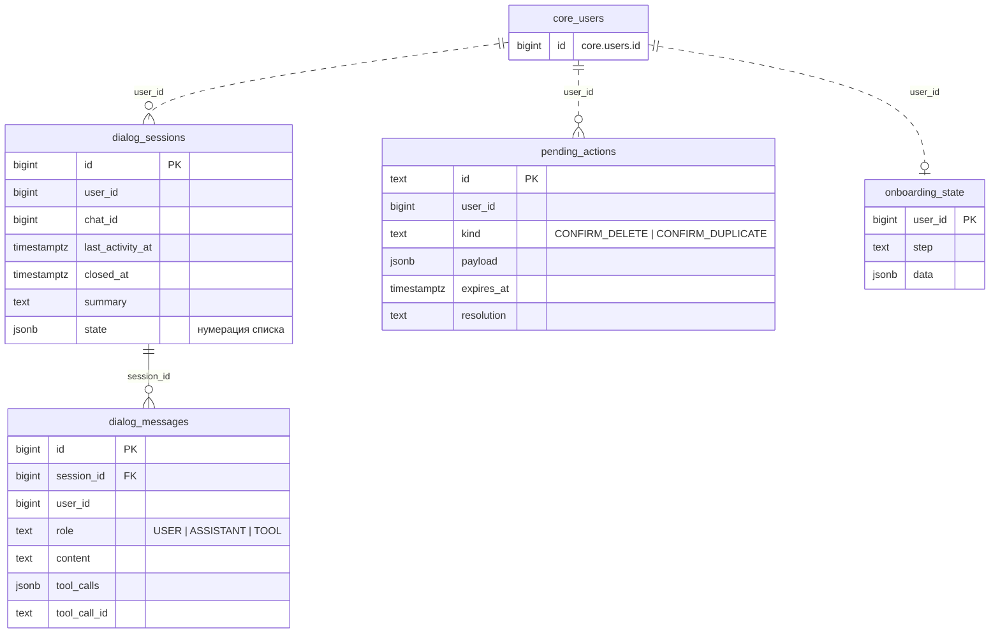
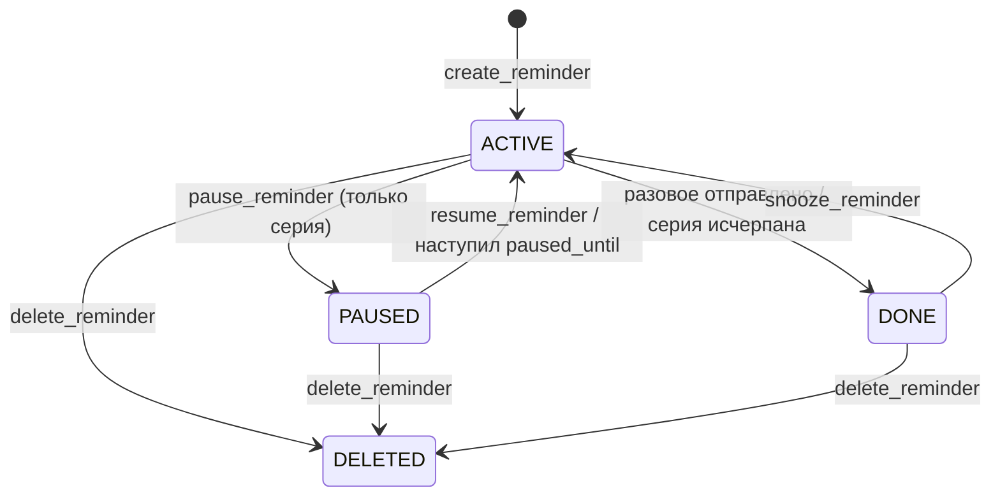
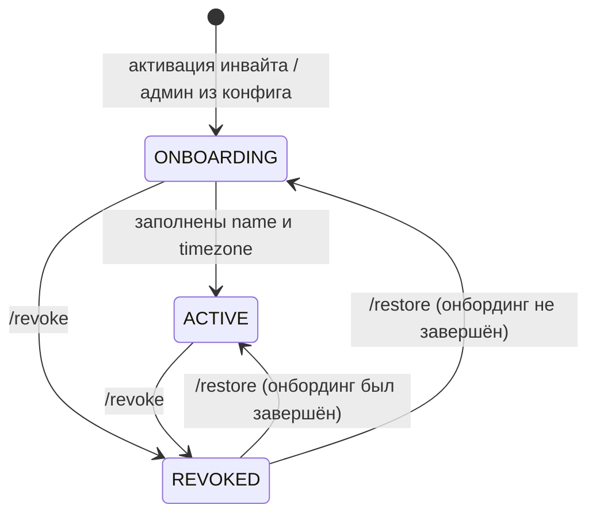

# Схема БД v1

Статус: утверждена владельцем 2026-11-02 (этап 1). Миграции Flyway пишутся по этому документу на этапах 2–4; после применения первой миграции документ описывает фактическую схему, а изменения идут только новыми аддитивными миграциями.

Решения и причины — `docs/DECISIONS.md`, раздел 11.

## Общее

- Один PostgreSQL, две схемы: `core` (сервис core) и `agent` (сервис agent). Каждый сервис мигрирует только свою схему своим Flyway (`flyway.schemas`), отдельные таблицы истории `flyway_schema_history` в каждой схеме. Сервис подключается под своей ролью БД с правами только на свою схему.
- agent **не читает** схему `core` — только через MCP/REST. Связь между схемами — логическая (`user_id`), без внешних ключей между схемами.
- Время — `timestamptz` (UTC). Локальное «настенное» время — `timestamp` (без зоны) **всегда в паре** с IANA-таймзоной.
- Статусы — enum в коде + `check` в БД. Значения в БД — `UPPER_SNAKE`.
- Каждая таблица с пользовательскими данными имеет `user_id` и индекс, начинающийся с него.
- Идентификаторы — `bigint generated always as identity`.
- `created_at`/`updated_at` выставляет код через `Clock` (не `default now()`), чтобы время было тестируемым.

## Диаграммы

Mermaid `erDiagram`, рендерится GitHub/GitLab и IntelliJ (плагин Mermaid). Показаны ключи и связи; полный список колонок — в таблицах ниже. Меняется вместе с таблицами.

### `core`

### `agent`

`user_id` — логическая ссылка на `core.users.id`, без внешнего ключа между схемами (пунктир).

### Статусы `reminders`

### Статусы `users`

## Схема `core`

### `users` — пользователи

| Колонка | Тип | Null | Описание |
|---|---|---|---|
| `id` | bigint PK | | внутренний id пользователя; именно он ходит между сервисами как `userId` |
| `telegram_chat_id` | bigint unique | | chatId личного чата с ботом |
| `role` | text | | `USER` \| `ADMIN` |
| `status` | text | | `ONBOARDING` \| `ACTIVE` \| `REVOKED` |
| `name` | text | да | как обращаться; заполняется в онбординге |
| `gender` | text | | грамматический род: `MALE` \| `FEMALE` \| `UNSPECIFIED` |
| `timezone` | text | да | IANA (`Europe/Moscow`); заполняется в онбординге, валидируется кодом |
| `monthly_cost_limit_usd` | numeric(12,6) | да | квота; `null` — без лимита. В v1 квоты выключены флагом конфига |
| `created_at` | timestamptz | | |
| `updated_at` | timestamptz | | |
| `onboarded_at` | timestamptz | да | момент перехода `ONBOARDING → ACTIVE` |
| `revoked_at` | timestamptz | да | |

- Переходы статуса: `ONBOARDING → ACTIVE` (код, когда заполнены `name` и `timezone`) · `ACTIVE/ONBOARDING → REVOKED` (админ, `/revoke`) · `REVOKED → ACTIVE` (админ, `/restore`; если онбординг не был завершён — `REVOKED → ONBOARDING`). При восстановлении `revoked_at` сбрасывается.
- Пока пользователь в `REVOKED`, планировщик не отправляет уведомления, а сдвигает `next_fire_at` дальше без отправки: после восстановления пропущенное не досылается.
- Админ создаётся core при старте из конфига (`THESEUS_ADMIN_CHAT_ID`), идемпотентно, со статусом `ONBOARDING` и ролью `ADMIN`; дальше — обычный онбординг.
- check: `status = 'ACTIVE'` ⇒ `name` и `timezone` не null.

### `invites` — инвайты

| Колонка | Тип | Null | Описание |
|---|---|---|---|
| `id` | bigint PK | | |
| `code_hash` | text unique | | SHA-256 от кода (hex). Сам код хранится только у админа в сообщении |
| `gender` | text | | род будущего пользователя: `MALE` \| `FEMALE` \| `UNSPECIFIED` |
| `label` | text | да | пометка админа («для мамы») — видна в `/users` и в уведомлении об активации |
| `created_at` | timestamptz | | |
| `expires_at` | timestamptz | | `created_at` + TTL (конфиг, по умолчанию 72 ч) |
| `used_at` | timestamptz | да | |
| `used_by_user_id` | bigint FK → users | да | |
| `revoked_at` | timestamptz | да | |

- Состояние инвайта **вычисляется**, не хранится: `USED` (есть `used_at`) → `REVOKED` (есть `revoked_at`) → `EXPIRED` (`expires_at ≤ now`) → иначе `ACTIVE`. Так нет рассинхрона статуса и времени.
- Код: 16 символов из алфавита без похожих символов (base32 Crockford), `SecureRandom`; уходит в deep link `t.me/<bot>?start=<код>` (лимит payload 64 символа — с запасом).
- Активация — одна транзакция: `select … for update` по `code_hash`, проверка состояния, создание пользователя, `used_at`/`used_by_user_id`.
- check: `used_at` и `used_by_user_id` заданы оба или ни один.

### `reminders` — напоминания

Одна строка — одно разовое напоминание **или** одна серия. Расписание задаётся одинаково: локальное время старта + таймзона (+ RRULE для серии). Колонка `next_fire_at` — производная: ближайшее срабатывание в UTC, её пересчитывает код после любого изменения и после каждой отправки; по ней работает планировщик.

| Колонка | Тип | Null | Описание |
|---|---|---|---|
| `id` | bigint PK | | |
| `user_id` | bigint FK → users | | |
| `text` | text | | что напомнить (до 1000 символов, check) |
| `timezone` | text | | IANA-таймзона, в которой задано расписание (снимок таймзоны пользователя на момент создания) |
| `start_local` | timestamp | | разовое — момент срабатывания; серия — первое срабатывание (`DTSTART` из RFC 5545), локальное время |
| `recurrence_rule` | text | да | `null` — разовое; иначе правило повторения в формате `RRULE` из RFC 5545, без `DTSTART` (`FREQ=WEEKLY;BYDAY=MO,WE`), собирает код |
| `excluded_occurrences` | timestamptz[] | | исключённые срабатывания серии (`EXDATE` из RFC 5545): пропуск, перенос одного срабатывания; по умолчанию `{}` |
| `parent_id` | bigint FK → reminders | да | для разового напоминания, созданного переносом одного срабатывания серии |
| `status` | text | | `ACTIVE` \| `PAUSED` \| `DONE` \| `DELETED` |
| `paused_until` | timestamptz | да | только для `PAUSED`; `null` — пауза бессрочная |
| `snoozed_until` | timestamptz | да | отложенное срабатывание (snooze); после отправки сбрасывается |
| `next_fire_at` | timestamptz | да | ближайшее срабатывание: `min(следующее по расписанию, snoozed_until)`; `null` — срабатываний больше нет |
| `last_fired_at` | timestamptz | да | |
| `created_at` | timestamptz | | |
| `updated_at` | timestamptz | | |
| `deleted_at` | timestamptz | да | |

- Статусы: `ACTIVE` — ждёт срабатывания · `PAUSED` — серия на паузе (только серии) · `DONE` — разовое отправлено / серия исчерпана (`UNTIL`/`COUNT`) · `DELETED` — удалено пользователем (мягкое удаление; физически не удаляем в v1).
  Это уточнение «`PENDING → SENT`» из `DECISIONS.md` §2: для разового `ACTIVE → DONE`, а факт отправки каждого срабатывания пишется в `reminder_deliveries`.
- check: `recurrence_rule is null` ⇒ `status <> 'PAUSED'` и `excluded_occurrences = '{}'`; `paused_until is not null` ⇒ `status = 'PAUSED'`; `status in ('DONE','DELETED')` ⇒ `next_fire_at is null`.
- Индексы: `(user_id, status)`; частичный `(next_fire_at) where status = 'ACTIVE'` — для планировщика; частичный `(paused_until) where status = 'PAUSED'` — для автоснятия паузы.
- Несуществующее локальное время (переход на летнее) сдвигается вперёд на величину перехода, неоднозначное (переход на зимнее) — берётся более раннее смещение. Считает код, кейсы — в тестах этапа 4.
- Смена таймзоны пользователя существующие напоминания **не** пересчитывает (см. открытый вопрос в `DECISIONS.md` §11).

### `reminder_deliveries` — журнал отправок

| Колонка | Тип | Null | Описание |
|---|---|---|---|
| `id` | bigint PK | | |
| `reminder_id` | bigint FK → reminders | | |
| `user_id` | bigint FK → users | | денормализовано для фильтрации по пользователю |
| `occurrence_at` | timestamptz | | плановое время срабатывания (для snooze — время отложенного срабатывания) |
| `kind` | text | | `SCHEDULED` \| `SNOOZED` |
| `status` | text | | `SENT` \| `FAILED` |
| `late` | boolean | | отправлено с опозданием (досыл после простоя) |
| `sent_at` | timestamptz | да | |
| `telegram_message_id` | bigint | да | id сообщения-уведомления; для reply и кнопок |
| `error` | text | да | причина `FAILED` (без текста напоминания) |
| `created_at` | timestamptz | | |

- unique `(reminder_id, occurrence_at, kind)` — идемпотентность: повторный тик планировщика не отправит дважды.
- Индексы: `(user_id, created_at)`; unique `(user_id, telegram_message_id)` — поиск напоминания по reply.

### `llm_usage` — учёт вызовов LLM

| Колонка | Тип | Null | Описание |
|---|---|---|---|
| `id` | bigint PK | | |
| `user_id` | bigint FK → users | | |
| `role` | text | | роль модели: `MAIN` \| `SUMMARY` \| `ROUTER` |
| `model` | text | | фактическая модель из ответа OpenRouter (после fallback) |
| `generation_id` | text | да | id генерации OpenRouter — для сверки |
| `tokens_in` | integer | | |
| `tokens_out` | integer | | |
| `tokens_cached` | integer | | по умолчанию 0 |
| `cost_usd` | numeric(12,8) | | стоимость из ответа OpenRouter |
| `latency_ms` | integer | да | |
| `created_at` | timestamptz | | |

- Индекс `(user_id, created_at)`. Тексты запросов/ответов **не** хранятся.

## Схема `agent`

### `dialog_sessions` — сессии диалога

Новая сессия начинается, если с `last_activity_at` прошло больше порога (конфиг, по умолчанию 4 ч). Старая сессия закрывается; её саммари может перейти в новую как стартовый контекст.

| Колонка | Тип | Null | Описание |
|---|---|---|---|
| `id` | bigint PK | | |
| `user_id` | bigint | | id пользователя core |
| `chat_id` | bigint | | |
| `started_at` | timestamptz | | |
| `last_activity_at` | timestamptz | | |
| `closed_at` | timestamptz | да | |
| `summary` | text | да | скользящее саммари всего, что старше окна последних сообщений |
| `summary_until_message_id` | bigint | да | последнее сообщение, вошедшее в саммари |
| `state` | jsonb | | состояние сессии: нумерация последнего списка (`номер → reminderId`) и т.п.; по умолчанию `{}` |

- Индекс `(user_id, last_activity_at)`; частичный unique `(user_id) where closed_at is null` — одна открытая сессия на пользователя.

### `dialog_messages` — сообщения

| Колонка | Тип | Null | Описание |
|---|---|---|---|
| `id` | bigint PK | | |
| `session_id` | bigint FK → dialog_sessions | | |
| `user_id` | bigint | | |
| `role` | text | | `USER` \| `ASSISTANT` \| `TOOL` |
| `content` | text | да | текст; для `TOOL` — сжатый результат инструмента |
| `tool_calls` | jsonb | да | для `ASSISTANT`: вызовы инструментов (имя, аргументы, id) |
| `tool_call_id` | text | да | для `TOOL`: на какой вызов ответ |
| `telegram_message_id` | bigint | да | входящее/исходящее сообщение Telegram |
| `created_at` | timestamptz | | |

- Индексы `(session_id, id)`, `(user_id, created_at)`.
- Хранение: сообщения старше N дней (конфиг, по умолчанию 30) удаляются фоновой задачей агента. Саммари сессии остаётся.

### `pending_actions` — ожидающие подтверждения

Действия, которые агент показал пользователю кнопками и ждёт ответа: подтверждение удаления, «всё равно создать» при дубле. `callback_data` кнопки содержит только `pa:<id>:<вариант>`, всё остальное — здесь.

| Колонка | Тип | Null | Описание |
|---|---|---|---|
| `id` | text PK | | короткий случайный id (12 символов base32) |
| `user_id` | bigint | | |
| `kind` | text | | `CONFIRM_DELETE` \| `CONFIRM_DUPLICATE` |
| `payload` | jsonb | | что выполнить при подтверждении: имя MCP-инструмента и аргументы |
| `telegram_message_id` | bigint | да | сообщение с кнопками — чтобы убрать кнопки после ответа |
| `created_at` | timestamptz | | |
| `expires_at` | timestamptz | | по умолчанию +24 ч |
| `resolved_at` | timestamptz | да | |
| `resolution` | text | да | `CONFIRMED` \| `CANCELLED` \| `EXPIRED` |

- Индекс `(user_id, created_at)`. Нажатие проверяет: `user_id` совпадает с пользователем чата, не истекло, не разрешено.

### `onboarding_state` — состояние онбординга

FSM онбординга детерминированный; шаг выводится из профиля в core (`name`/`timezone` пусты), здесь — только промежуточное состояние, которого в профиле нет.

| Колонка | Тип | Null | Описание |
|---|---|---|---|
| `user_id` | bigint PK | | |
| `step` | text | | `AWAIT_NAME` \| `AWAIT_TIMEZONE` \| `AWAIT_TIMEZONE_CONFIRM` |
| `data` | jsonb | | напр. предложенная таймзона до подтверждения; по умолчанию `{}` |
| `updated_at` | timestamptz | | |

- Строка удаляется после завершения онбординга.
